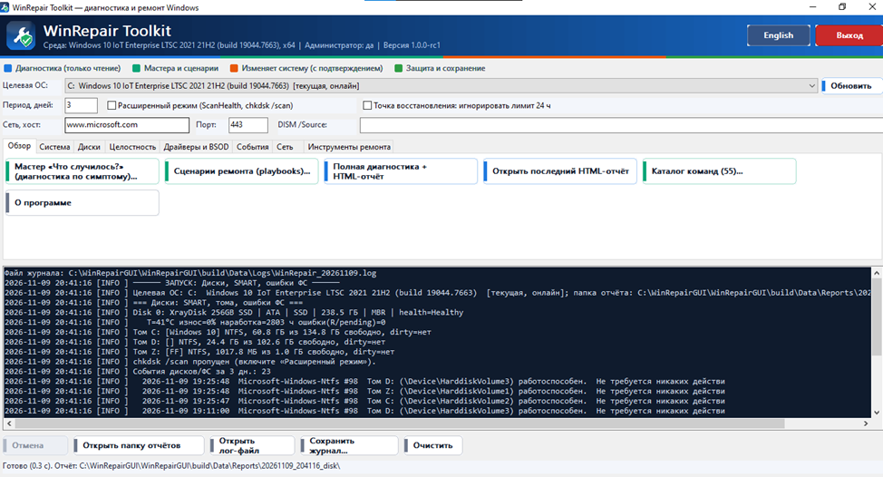
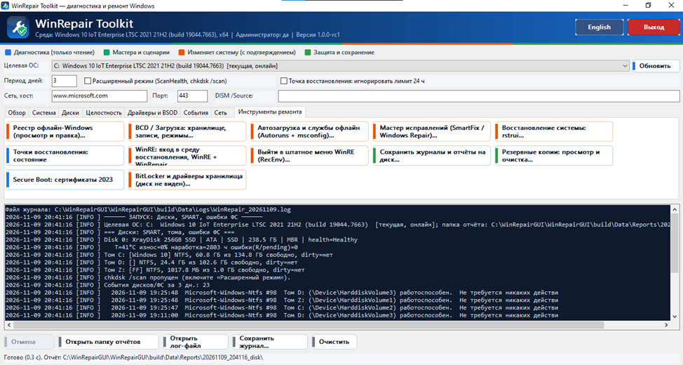

# WinRepair Toolkit — offline Windows diagnostics and repair

A single `WinRepair.exe`, no installation: diagnose and repair a Windows that will not boot — from WinPE, WinRE, or straight from a running system.
It works with several installed systems at once (C:, D:…) and needs **no** .NET, PowerShell or VC++ Redistributable.

**What it does:** offline registry editor (regedit-style), BCD and boot options, startup items and services (Autoruns-style), removal of programs that block Windows from starting (e.g. an antivirus), offline file explorer, "What happened?" wizard, BitLocker and storage drivers, WinRE, repair playbooks, reports. The interface is in English and Russian (button at the top right).

## ⬇ Download

| File | For |
|---|---|
| [**WinRepair_x64.exe**](../../releases/latest/download/WinRepair_x64.exe) | 64-bit Windows 10/11 and WinPE/WinRE — **main file** |
| [WinRepair_x86.exe](../../releases/latest/download/WinRepair_x86.exe) | 32-bit systems |
| [Full package (zip) and checksums](../../releases/latest) | both exe files, repair playbooks, documentation, SHA-256 |

**Quick start:** download `WinRepair_x64.exe` → run it **as administrator** → pick the *Target OS* (to repair another disk, choose the offline system). For WinPE/WinRE: copy the file to a USB stick and run it from there.
Windows SmartScreen may warn about an unknown publisher (the exe is not code-signed yet): *More info → Run anyway*. You can verify the file with the SHA-256 value in the release.

All versions and changes: [Releases](../../releases) and `CHANGELOG.md`. Found a bug? Open an [issue](../../issues).

---

## Features

### Repair tools (tab "Repair tools")
All windows work with the **selected offline Windows** (not with WinPE itself).
* **Offline registry** — several systems loaded at once (C:, D:…), each as its own branch of the tree; *File* menu: load/unload a disk's registry, load a hive from a file; addresses like `D:\SYSTEM\ControlSet001`. Hives SYSTEM/SOFTWARE/SAM/SECURITY/DEFAULT/COMPONENTS and every profile's NTUSER/UsrClass. Create/edit/delete/rename keys and values, search, favourites, export `.reg`. Every hive is copied before loading, every change is confirmed, backed up (.reg) and logged.
* **BCD / Boot** — finds BCD stores on all volumes (including ESP and hidden partitions), entry list and editing, backup/restore, `bcdboot`, boot modes (Safe Mode variants, boot log, VGA, debug, no driver-signature check, testsigning…), reboot (also into WinRE). The store is backed up automatically before any change.
* **Startup and services (Autoruns + msconfig)** — Run/RunOnce, Startup folders, Winlogon, IFEO Debugger, AppInit_DLLs, BootExecute, services, drivers, scheduled tasks; "file missing / suspicious" marks, quick filter, disable/enable (reversible), delete, edit command, clean-boot mode with rollback, CSV export. Re-scans automatically when you change the disk.
* **Installed applications (offline)** — the programs of the selected offline system; forced removal of an app that stops Windows from starting (startup items disabled, folder quarantined, uninstall entry deleted with a `.reg` backup).
* **Offline file explorer** — browse the selected system's files, copy, move to quarantine, delete, take ownership/permissions, search.
* **Infection fix wizard** — Winlogon Shell/Userinit, IFEO, AppInit, policies, proxy, hosts, key services, file associations, SafeBoot, Windows Update reset, network/WMI reset, pending operations, hive replacement from RegBack.
* **System Restore** (`rstrui`, restore points, shadow copies of the target OS).
* **WinRE** — enter WinRE on next boot, create/repair the WinRE BCD entry, WinRE + WinRepair (a copy of `winre.wim` that starts WinRepair first), Secure Boot 2023 certificate check.
* **BitLocker and storage drivers** — unlock with a recovery password/password/.bek key (secrets are never written to logs), status/suspend/resume; devices without drivers (Intel VMD/RST hints), `drvload` in WinPE/WinRE, `DISM /Add-Driver` into the offline Windows.

### "What happened?" wizard (tab "Overview")
Pick a symptom (does not boot, blue screen, disk not visible, suspected malware, no network, slow/reboots, updates fail) and a target OS. The program runs read-only checks (BitLocker, SMART, GPT/ESP and BCD, hives, pending updates, CBS.log, WinRE, last BugCheck from the dump, events, startup items, policies, hosts, proxy, services, network) and lists findings by severity with a recommended action. Every action asks for confirmation and is logged. The result is saved as `triage.txt` / `triage.json`.

### Playbooks
`*.wrp` files in `Playbooks\` next to the exe add **new repair procedures and symptoms without recompiling** (messages, questions, confirmations, commands, fixes, modules, custom checks). Every risky step is confirmed separately and logged. Format: `docs/PLAYBOOKS.md`. Copy the `Playbooks` folder next to `WinRepair.exe` (to the USB stick or WinPE image as well).

### Command catalog (79 commands)
Tab "Overview" → *Command catalog*. Filter by category, parameter fields, exact command line. **Every run needs separate confirmation**; dangerous operations (`bcdboot`, `bootrec /fixmbr|/fixboot|/rebuildbcd`, `chkdsk /f /r`) ask twice. Output goes to the log and to `Data\Reports\<time>_cmdNN\`; a separate audit log is kept in `Data\Logs\commands_<date>.log`. Many commands are native (no PowerShell needed); DISM/SFC switch to `/Image:` and `/offwindir` automatically for an offline target.

### Safety
Confirmation before every change · backup before every change (hives, BCD, .reg of the branch) · quarantine instead of deletion · full change log. See `SECURITY.md` and `PRIVACY.md` (the program sends no data anywhere).

## Usage notes
* Log: `Data\Logs\WinRepair_<date>.log` (or `%TEMP%\WinRepair\` if the program folder is read-only). Reports: `Data\Reports\<time>_<module>\`.
* No UI: `WinRepair.exe /full [/out:folder]` — full diagnostics + HTML report.
* Optional: put `cdb.exe` (Debugging Tools) into `Tools\` for `!analyze -v` on crash dumps.
* **In WinPE:** boot WinPE, run the exe from USB/network, choose the installed Windows in "Target OS". Event logs are read from `*.evtx`, DISM/SFC/chkdsk use `/Image` / `/offwindir`, dumps are taken from `<OS>\Minidump`.
* **Language:** button "English" / "Русский" at the top right or `/lang:en`; the choice is stored in `WinRepair.ini`. Extra languages: `Lang\<code>.txt` (see `docs/LOCALIZATION.md`).

## Build from source
* **MSVC** (VS 2019/2022 + Windows 10/11 SDK): open *x64 Native Tools Command Prompt* → `build_msvc.bat` (x86: *x86 Native Tools*).
* **MinGW-w64** (MSYS2): `build_mingw.bat`.
* Core tests: `./run_tests.sh` (any g++).
Result: `build\WinRepair.exe` (static CRT, no external DLLs). Release package: `make_package.bat x64|x86` → `dist\WinRepair\`. Details: `docs/BUILD.md`, `docs/RELEASE.md`.
GitHub publishing guide: `docs/GITHUB_GUIDE.md` (Russian: `docs/GITHUB_GUIDE.ru.md`). Contributing: `CONTRIBUTING.md`. CI and release workflows: `.github/workflows`.

## License
MIT — see [LICENSE.txt](LICENSE.txt). Free to use, modify and distribute, including commercially, keeping the copyright notice. The program changes system files and the registry of other Windows installations: keep backups (the program makes its own before each change).
