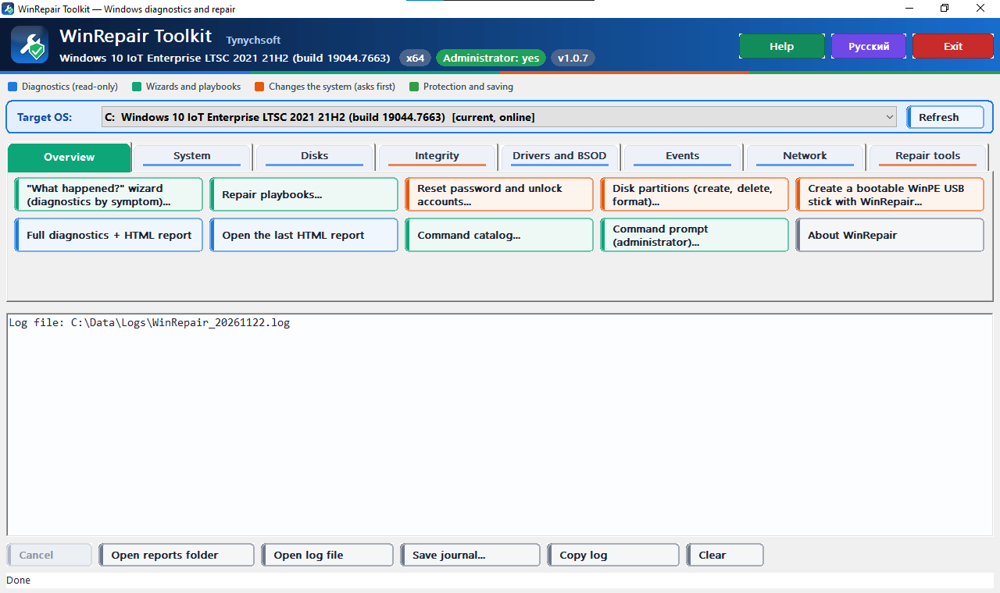
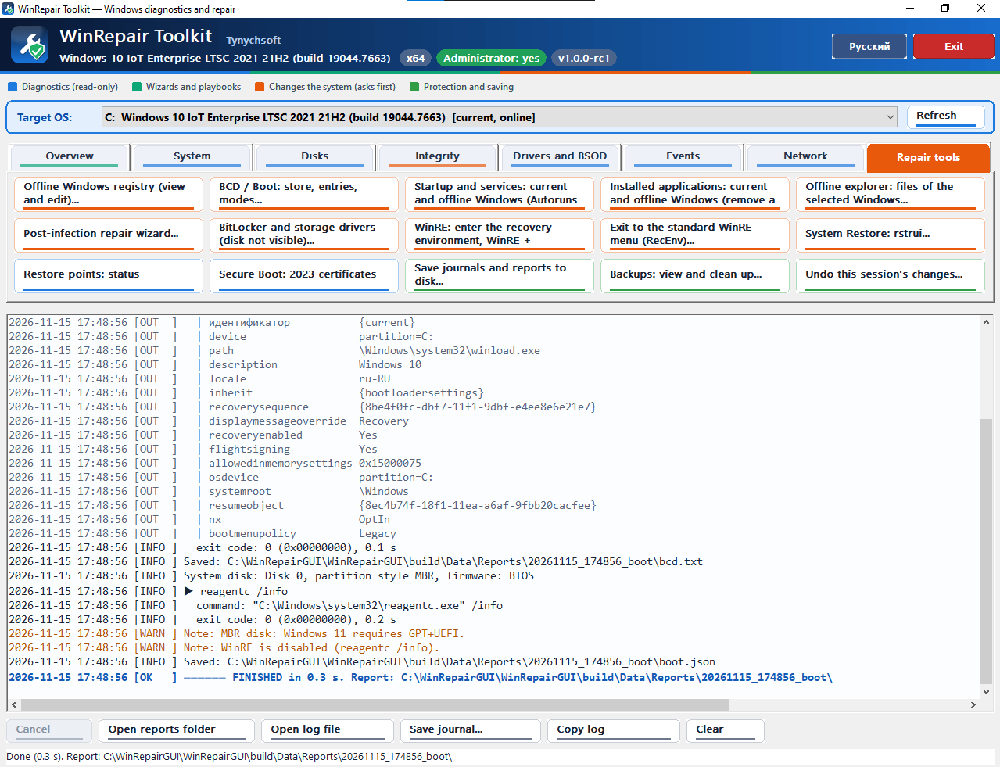

# WinRepair Toolkit — офлайн-диагностика и ремонт Windows

> *От Tynychsoft.* 🇬🇧 [English](../README.md) · 📖 [Знакомство с программой](INTRO.ru.md)

Один файл `WinRepair.exe`, без установки: диагностика и ремонт Windows, которая не загружается, — из WinPE, WinRE или прямо из работающей системы.
Работает сразу с несколькими установленными системами (C:, D:…) и **не требует** .NET, PowerShell и VC++ Redistributable.

**Что умеет:** офлайн-редактор реестра (как regedit), BCD и параметры загрузки, автозагрузка и службы (как Autoruns), удаление программ, мешающих запуску Windows (например, антивируса), офлайн-проводник, мастер «Что случилось?», BitLocker и драйверы хранилища, WinRE, **собственная загрузочная флешка WinPE** с автозапуском WinRepair, **откат всех изменений сессии в один клик**, сценарии ремонта, отчёты. Интерфейс на русском и английском (кнопка справа вверху).

## ⬇ Скачать

| Файл | Для чего |
|---|---|
| [**WinRepair_x64.exe**](../../../releases/latest/download/WinRepair_x64.exe) | 64-bit Windows 10/11 и WinPE/WinRE — **основной файл** |
| [WinRepair_x86.exe](../../../releases/latest/download/WinRepair_x86.exe) | 32-bit системы |
| [WinRepair_arm64.exe](../../../releases/latest/download/WinRepair_arm64.exe) | Windows on ARM (Snapdragon и другие ARM64-ПК); нужен для их WinPE/WinRE — x64-версия там не запустится |
| [Полный пакет (zip) и контрольные суммы](../../../releases/latest) | оба exe, сценарии ремонта, документация, SHA-256 |

**Быстрый старт:** скачайте `WinRepair_x64.exe` → запустите **от имени администратора** → выберите *Целевую ОС* (чтобы чинить другой диск, укажите офлайн-систему). Для WinPE/WinRE: скопируйте файл на флешку и запустите оттуда.
SmartScreen может предупредить о неизвестном издателе (exe пока без подписи): *Подробнее → Выполнить в любом случае*. Файл можно проверить по SHA-256 из релиза.

Все версии и изменения: [Releases](../../../releases) и `CHANGELOG.md`. Нашли ошибку? Создайте [issue](../../../issues).

---

## Возможности

### Инструменты ремонта (вкладка «Инструменты ремонта»)
Все окна работают с **выбранной офлайн-Windows** (а не с самой WinPE).
* **Офлайн-реестр** — несколько систем одновременно (C:, D:…), каждая отдельной веткой дерева; меню *Файл*: загрузить/выгрузить реестр диска, загрузить куст из файла; адреса вида `D:\SYSTEM\ControlSet001`. Кусты SYSTEM/SOFTWARE/SAM/SECURITY/DEFAULT/COMPONENTS и NTUSER/UsrClass каждого профиля. Создание/изменение/удаление/переименование ключей и значений, поиск, избранное, экспорт `.reg`. Каждый куст копируется перед загрузкой, каждое изменение подтверждается, резервируется (.reg) и пишется в журнал.
* **BCD / Загрузка** — находит хранилища BCD на всех томах (включая ESP и скрытые разделы), список и правка записей, резервирование/восстановление, `bcdboot`, режимы загрузки (варианты безопасного режима, журнал загрузки, VGA, отладка, без проверки подписи драйверов, testsigning…), перезагрузка (в том числе в WinRE). Перед любым изменением хранилище копируется автоматически.
* **Автозагрузка и службы (Autoruns + msconfig)** — Run/RunOnce, папки Startup, Winlogon, IFEO Debugger, AppInit_DLLs, BootExecute, службы, драйверы, задания планировщика; пометки «файл отсутствует / подозрительный», быстрый фильтр, отключение/включение (обратимо), удаление, правка команды, режим чистой загрузки с откатом, экспорт в CSV. При смене диска пересканируется автоматически.
* **Установленные программы (офлайн)** — программы выбранной офлайн-системы; принудительное удаление приложения, из-за которого Windows не стартует (автозапуск отключается, папка уходит в карантин, запись об удалении стирается с резервной копией `.reg`).
* **Офлайн-проводник** — просмотр файлов выбранной системы, копирование, перенос в карантин, удаление, смена владельца/прав, поиск.
* **Мастер лечения заражения** — Winlogon Shell/Userinit, IFEO, AppInit, политики, прокси, hosts, ключевые службы, ассоциации файлов, SafeBoot, сброс Windows Update, сброс сети/WMI, отложенные операции, замена кустов из RegBack.
* **Восстановление системы** (`rstrui`, точки восстановления, теневые копии целевой ОС).
* **WinRE** — вход в WinRE при следующей загрузке, создание/починка записи WinRE в BCD, WinRE + WinRepair (копия `winre.wim`, в которой WinRepair стартует первым; учитывает прошивку — выбирает `winload.efi`/`winload.exe` для UEFI/BIOS, обходит тома, зашифрованные BitLocker), проверка сертификата Secure Boot 2023.
* **Загрузочная флешка WinPE — независимый инструмент ремонта** 🆕 — одна кнопка («Создать загрузочную флешку WinPE с WinRepair…», есть и на вкладке «Обзор») собирает вашу собственную WinPE, где **WinRepair запускается первым и сам** — сторонние сборки WinPE не нужны. Основа: **ADK WinPE** (рекомендуется — чистый образ, гарантированный автозапуск; «Восстановление системы» `rstrui` добавляется из работающей Windows, так что точки восстановления работают офлайн) или `winre.wim` этой системы. Загрузочные файлы берутся из ADK Media или живой системы; укажите корень FAT32-флешки — она загрузится на любом UEFI-ПК при **включённом Secure Boot** (файлы подписаны Microsoft). Сценарии ремонта и языки упаковываются автоматически. Готовый образ — для личного использования: лицензия Microsoft запрещает его распространять, поэтому каждый собирает свой одним кликом.
* **Windows on ARM** 🆕 — нативный `WinRepair_arm64.exe` для Snapdragon и других ARM64-ПК; конструктор WinPE и средства WinRE сами подбирают нужную архитектуру (загрузочные файлы, ADK WinPE для ARM64).
* **Откат изменений сессии** 🆕 — программа ведёт журнал всего, что изменила за сессию (кусты реестра и импорт `.reg`, файлы, BCD, помещённое в карантин), и одна кнопка откатывает всё в безопасном порядке; после перезапуска она предложит и изменения прошлой сессии.
* **BitLocker и драйверы хранилища** — разблокировка паролем восстановления/паролем/ключом .bek (секреты в журналы не попадают), статус/приостановка/возобновление; устройства без драйверов (подсказки Intel VMD/RST), `drvload` в WinPE/WinRE, `DISM /Add-Driver` в офлайн-Windows.

### Мастер «Что случилось?» (вкладка «Обзор»)
Выберите симптом (не загружается, синий экран, не виден диск, подозрение на вирус, нет сети, тормозит/перезагружается, не ставятся обновления) и целевую ОС. Программа выполняет проверки только для чтения (BitLocker, SMART, GPT/ESP и BCD, кусты, отложенные обновления, CBS.log, WinRE, последний BugCheck из дампа, события, автозагрузка, политики, hosts, прокси, службы, сеть) и выводит находки по важности с рекомендуемым действием. Каждое действие требует подтверждения и пишется в журнал. Результат сохраняется в `triage.txt` / `triage.json`.

### Сценарии ремонта (Playbooks)
Файлы `*.wrp` в папке `Playbooks\` рядом с exe добавляют **новые процедуры ремонта и симптомы без перекомпиляции** (сообщения, вопросы, подтверждения, команды, исправления, модули, свои проверки). Каждый рискованный шаг подтверждается отдельно и журналируется. Формат: `docs/PLAYBOOKS.md`. Копируйте папку `Playbooks` рядом с `WinRepair.exe` (в том числе на флешку и в образ WinPE).

### Каталог команд (79 команд)
Вкладка «Обзор» → *Каталог команд*. Фильтр по категориям, поля параметров, точная командная строка. **Каждый запуск требует отдельного подтверждения**; опасные операции (`bcdboot`, `bootrec /fixmbr|/fixboot|/rebuildbcd`, `chkdsk /f /r`) спрашивают дважды. Вывод идёт в журнал и в `Data\Reports\<время>_cmdNN\`; отдельный аудит-журнал — `Data\Logs\commands_<дата>.log`. Многие команды встроенные (PowerShell не нужен); DISM/SFC для офлайн-цели сами переключаются на `/Image:` и `/offwindir`.

### Безопасность
Подтверждение перед каждым изменением · резервная копия перед каждым изменением (кусты, BCD, .reg ветки) · карантин вместо удаления · полный журнал изменений. См. `SECURITY.md` и `PRIVACY.md` (программа ничего никуда не отправляет).

## Заметки по использованию
* Журнал: `Data\Logs\WinRepair_<дата>.log` (или `%TEMP%\WinRepair\`, если папка программы только для чтения). Отчёты: `Data\Reports\<время>_<модуль>\`.
* Без интерфейса: `WinRepair.exe /full [/out:папка]` — полная диагностика + HTML-отчёт.
* По желанию: положите `cdb.exe` (Debugging Tools) в `Tools\` для `!analyze -v` по дампам.
* **Своя флешка WinPE:** отформатируйте флешку в FAT32, нажмите «Создать загрузочную флешку WinPE с WinRepair…», укажите корень флешки и загрузитесь с неё (Boot Menu, UEFI-запись) — WinRepair откроется сам; «Восстановление системы: rstrui…» откатит установленную Windows к точке восстановления офлайн.
* **В WinPE:** загрузите WinPE, запустите exe с USB/сети, выберите установленную Windows в «Целевая ОС». Журналы событий читаются из `*.evtx`, DISM/SFC/chkdsk используют `/Image` / `/offwindir`, дампы берутся из `<ОС>\Minidump`.
* **Язык:** кнопка «English» / «Русский» справа вверху или `/lang:ru`; выбор хранится в `WinRepair.ini`. Дополнительные языки: `Lang\<код>.txt` (см. `docs/LOCALIZATION.md`).

## Сборка из исходников
* **MSVC** (VS 2019/2022 + Windows 10/11 SDK): *x64 Native Tools Command Prompt* → `build_msvc.bat` (x86: *x86 Native Tools*).
* **MinGW-w64** (MSYS2): `build_mingw.bat`.
* Тесты ядра: `./run_tests.sh` (любой g++).
Результат: `build\WinRepair.exe` (статический CRT, без внешних DLL). Релизный пакет: `make_package.bat x64|x86|arm64` → `dist\WinRepair\` (ARM64: *ARM64 Native Tools* или кросс-консоль *x64_arm64*). Подробности: `docs/BUILD.md`, `docs/RELEASE.md`.
Руководство по публикации на GitHub: `docs/GITHUB_GUIDE.ru.md`. Участие в проекте: `CONTRIBUTING.md`. CI и релизы: `.github/workflows`.

## Лицензия
MIT — см. [LICENSE.txt](../LICENSE.txt). Свободно используйте, изменяйте и распространяйте, в том числе коммерчески, сохраняя уведомление об авторстве. Программа меняет системные файлы и реестр других установок Windows: делайте резервные копии (перед каждым изменением программа делает свои).
